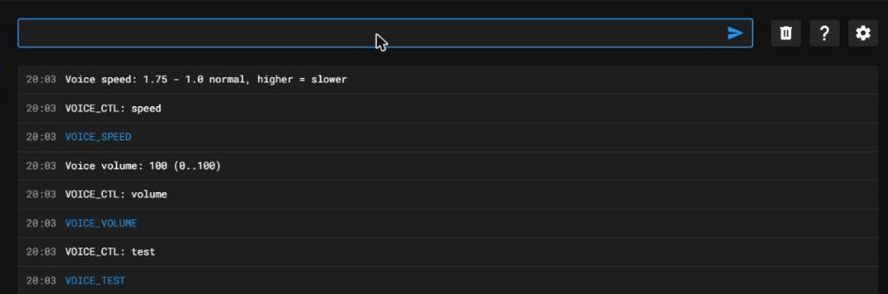
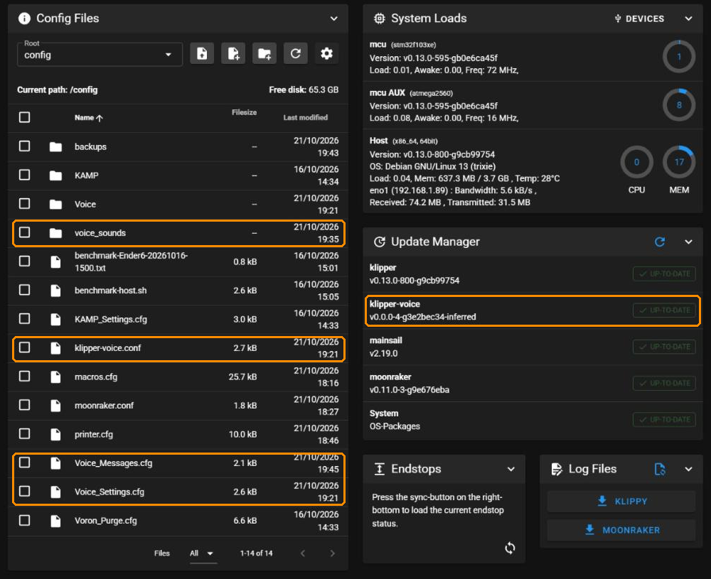
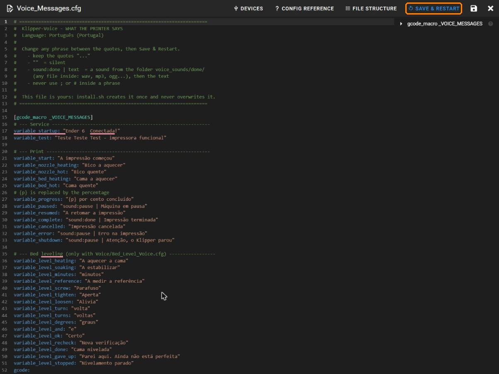
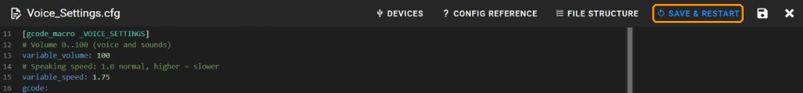
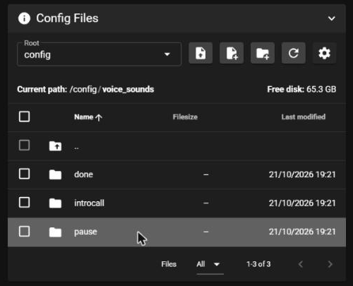
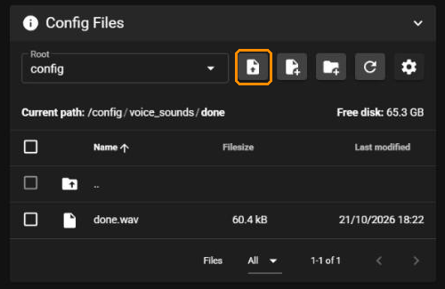
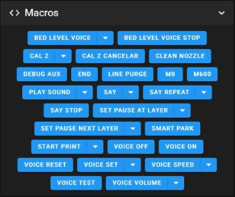
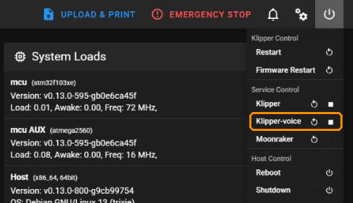

# Klipper-Voice — Manual de utilização

[English](MANUAL.md) | **Português**

Este manual mostra como usar o Klipper-Voice no dia a dia a partir do Mainsail. Para o instalar, vê o [README](README.pt.md). Tudo o que está aqui faz-se no browser; não precisas de SSH.

> [!WARNING]
> **Ainda por testar.** As imagens vêm da única máquina testada até agora: um mini PC x86 com Debian 13 e Mainsail. O Raspberry Pi e o Fluidd ainda não foram testados; no Fluidd os menus têm outros nomes, mas os ficheiros são os mesmos. Só as frases em português de Portugal foram revistas por alguém nativo; as outras línguas foram escritas com ajuda de IA. As correções são bem-vindas num [issue](https://github.com/3devangelist/Klipper-Voice/issues).

## Índice

1. [O que vais ouvir](#1-o-que-vais-ouvir)
2. [Testar a voz](#2-testar-a-voz)
3. [Onde está cada coisa](#3-onde-está-cada-coisa)
4. [Mudar o que a impressora diz](#4-mudar-o-que-a-impressora-diz)
5. [Volume e velocidade](#5-volume-e-velocidade)
6. [Os teus próprios sons](#6-os-teus-próprios-sons)
7. [Frases a partir do slicer e das tuas macros](#7-frases-a-partir-do-slicer-e-das-tuas-macros)
8. [Macros de exemplo](#8-macros-de-exemplo)
9. [Os botões das macros](#9-os-botões-das-macros)
10. [Reiniciar a voz](#10-reiniciar-a-voz)
11. [Atualizações](#11-atualizações)
12. [Nivelar a cama por voz](#12-nivelar-a-cama-por-voz)
13. [Se algo não estiver bem
    
    ](#13-se-algo-não-estiver-bem)

## 1. Instalação

"Caude coloca informação simplificada e manda para a pagina incial"

# 

## 2. O que vais ouvir

| Momento                                  | Exemplo (português de Portugal)                                            |
| ---------------------------------------- | -------------------------------------------------------------------------- |
| O Klipper-Voice arranca                  | Impressora conectada!                                                      |
| Começa uma impressão                     | A impressão começou                                                        |
| A cama ou o bico aquecem e ficam quentes | Cama a aquecer … Cama quente … Bico a aquecer … Bico quente                |
| A cada 10 %                              | 10 por cento concluído                                                     |
| Pausa (fim de filamento, troca de cor)   | *som de pausa* + Máquina em pausa, repetido de 5 em 5 minutos até voltares |
| A impressão continua                     | A retomar a impressão                                                      |
| Impressão terminada                      | *som de fim* + Impressão terminada                                         |
| Impressão cancelada                      | Impressão cancelada                                                        |
| Erro, ou o Klipper para                  | *som de pausa* + Erro na impressão / Atenção, o Klipper parou              |

Antes de cada mensagem ouves um pequeno **introcall** (o "ding-dong" dos centros comerciais), para saberes que vem aí uma mensagem. Não toca quando as mensagens vêm seguidas, por exemplo durante o nivelamento da cama.

## 3. Testar a voz

Abre a **Console** e escreve **`VOICE`**. A impressora diz a frase de teste, e a consola mostra o volume, a velocidade e se a voz está ligada.

O `VOICE` é o único comando de que precisas para controlar a voz; tudo o resto são parâmetros dele (secções 5 e 7).

"claude" compoem e completa


SAY MSG="sound:introcall | Obtenção de zero"


SAY MSG="sound:pause | Trabalho Cancelado"

SAY MSG="sound:done | Trabalho Finalizado com Sucesso"




## 4. Onde está cada coisa

Abre **Machine**. O Klipper-Voice usa estes ficheiros e pastas, ao lado do `printer.cfg`:



| Ficheiro / pasta     | O que tem                                                                              |
| -------------------- | -------------------------------------------------------------------------------------- |
| `Voice_Messages.cfg` | **o que a impressora diz**: todas as frases                                            |
| `Voice_Settings.cfg` | **volume e velocidade**, e as definições do nivelamento da cama                        |
| `voice_sounds/`      | **os sons**: uma pasta por som                                                         |
| `klipper-voice.conf` | definições técnicas (intervalos, introcall, modo noturno). Normalmente nunca lhe mexes |
| `Voice/`             | as macros do próprio programa. **Não edites**: são substituídas a cada atualização     |

À direita, o **Update Manager** mostra o `klipper-voice`, para o atualizares como o Klipper e o Mainsail.

## 5. Mudar o que a impressora diz

1. Em **Machine**, clica em **`Voice_Messages.cfg`**.
2. Muda o texto **entre aspas**.
3. Clica em **SAVE & RESTART** (canto superior direito).



Regras simples:

- **Mantém as aspas:** `variable_complete: "A tua peça está pronta"`.
- **Aspas vazias = silêncio:** `variable_start: ""` faz com que o início da impressão não seja anunciado.
- **Um som antes do texto:** `"sound:done | A tua peça está pronta"` toca um som da pasta `voice_sounds/done/` e depois diz o texto.
- **Percentagem:** em `variable_progress`, o `{p}` passa a ser o número: `"{p} por cento concluído"`.
- **Nunca uses `;` nem `#`** dentro de uma frase. O Klipper lê-os como início de um comentário e corta a frase.
- **O nome da tua impressora:** por exemplo `variable_startup: "Ender 6 conectada!"`.

As frases do nivelamento da cama estão no fim do mesmo ficheiro.

> [!CAUTION]
> **Uma aspa esquecida para o Klipper.** O `Voice_Messages.cfg` é lido pelo Klipper como o `printer.cfg`, por isso uma linha estragada, por exemplo sem uma das aspas, impede o Klipper de arrancar até ser corrigida. O Klipper mostra o ficheiro e a linha com o problema: abre outra vez o `Voice_Messages.cfg`, corrige essa linha e clica em **SAVE & RESTART**. É o preço de ter todas as frases num só ficheiro simples, editável no Mainsail.

## 6. Volume e velocidade

Estão no topo do **`Voice_Settings.cfg`**:



- `variable_volume`: de 0 a 100, para a voz e para todos os sons.
- `variable_speed`: 1.0 é a velocidade normal; um número maior fala mais devagar (1.5, 1.75…).

Muda o número e clica em **SAVE & RESTART**.

**Mais rápido, de ouvido, pela Console:**

```
VOICE VOLUME=70
VOICE SPEED=1.6
VOICE VOLUME=70 SPEED=1.6
```

A mudança é aplicada logo e a impressora diz a frase de teste, para ouvires o resultado. O valor também fica gravado no `Voice_Settings.cfg`, por isso mantém-se depois de reiniciar.

**Ainda se percebe mal?** Cada coluna é diferente. No `klipper-voice.conf`, a linha `effects` em `[voice]` define como a voz é processada, e o ficheiro traz quatro opções escritas nos comentários (leve, coluna pequena, consoantes claras, pura). Troca a linha por outra opção e reinicia a voz (secção 10). O [README](README.pt.md#processamento-do-som-voz-clara-na-tua-coluna) explica como compará-las por SSH.

## 7. Os teus próprios sons

A pasta `voice_sounds/` tem uma pasta por som:



| Pasta        | Toca                                                                                           |
| ------------ | ---------------------------------------------------------------------------------------------- |
| `pause/`     | quando a impressora precisa de ti: pausa, fim de filamento, troca de cor, erro, Klipper parado |
| `done/`      | impressão terminada                                                                            |
| `introcall/` | antes de cada mensagem (o "ding-dong")                                                         |

Para trocar um som:

1. Abre a pasta, por exemplo `done`.
2. Clica no botão de **carregar ficheiro** (marcado a laranja) e escolhe o teu ficheiro.



- **Qualquer nome** e **qualquer formato comum**: mp3, wav, ogg, flac…
- **Vários ficheiros na mesma pasta?** É escolhido um ao acaso de cada vez.
- **Para voltar ao som antigo**, apaga o teu e deixa o ficheiro original.
- Uma **pasta vazia** não toca som, mas a frase é dita na mesma.
- Ficheiros MIDI (`.mid`) não funcionam. Converte-os primeiro para mp3.

## 8. Frases a partir do slicer e das tuas macros

O G-code personalizado do teu slicer, e as tuas próprias macros, também podem falar.

**Dizer alguma coisa:**

```gcode
SAY MSG="Primeira camada feita"
```

**Dar a um evento uma frase só para esta impressão**, por exemplo logo no início do *Start G-code* do slicer:

```gcode
VOICE EVENT=complete MSG="O suporte do robô está pronto"
VOICE EVENT=progress MSG="%p por cento do suporte"
```

- No slicer, escreve `%p` para a percentagem (o slicer usa `{}` para si próprio).
- `MSG=""` deixa esse evento em silêncio nesta impressão.
- Quando a impressão acaba, voltam as frases do `Voice_Messages.cfg`.

**Todos os comandos:**

| Comando                                   | O que faz                                                         |
| ----------------------------------------- | ----------------------------------------------------------------- |
| `SAY MSG="texto"`                         | diz o texto                                                       |
| `PLAY_SOUND FILE=done`                    | toca um som de uma pasta de `voice_sounds`                        |
| `SAY_REPEAT SEC=60 MSG="Falta filamento"` | repete até `SAY_STOP`, ou até uma impressão começar ou continuar  |
| `SAY_STOP`                                | para a repetição                                                  |
| `VOICE`                                   | frase de teste + volume, velocidade e ligado/desligado na consola |
| `VOICE VOLUME=70` / `VOICE SPEED=1.6`     | volume / velocidade (secção 5)                                    |
| `VOICE MUTE=1` / `VOICE MUTE=0`           | desliga / liga a voz (os erros são sempre ditos)                  |
| `VOICE EVENT=complete MSG="..."`          | frase própria para um evento, nesta impressão                     |
| `VOICE RESET=1`                           | cancela as frases do `VOICE EVENT=`                               |

O Klipper só aceita parâmetros `NOME=valor`, por isso é `VOICE MUTE=1` e não `VOICE OFF`.

## 9. Macros de exemplo

Copia-as para o teu ficheiro de macros (por exemplo `macros.cfg`), nunca para a pasta `Voice/`. Põe as frases à tua maneira e faz **SAVE & RESTART**. Os eventos automáticos (início da impressão, aquecimento, pausa, fim…) já são ditos: não lhes acrescentes `SAY`, senão ouves tudo duas vezes.

**Etapas da tua macro de início.** Acrescenta linhas `SAY` ao `START_PRINT` que já tens, sem mudar mais nada:

```ini
[gcode_macro START_PRINT]
gcode:
    # ... as tuas linhas ...
    SAY MSG="A fazer o home"
    G28
    SAY MSG="A fazer a malha da cama"
    BED_MESH_CALIBRATE
    SAY MSG="A purgar"
    # ... a tua linha de purga ...
```

**Carregar e descarregar filamento:**

```ini
[gcode_macro LOAD_FILAMENT]
gcode:
    SAY MSG="A carregar filamento"
    M83
    G1 E50 F300
    G1 E25 F150
    SAY MSG="Filamento carregado"

[gcode_macro UNLOAD_FILAMENT]
gcode:
    SAY MSG="A descarregar filamento"
    M83
    G1 E10 F300
    G1 E-60 F1200
    SAY MSG="Filamento fora, já podes puxar"
```

O extrusor tem de estar quente primeiro. Ajusta os comprimentos à tua impressora.

**Dizer porque parou.** A pausa já é anunciada; isto acrescenta o motivo quando o sensor de filamento dispara:

```ini
[filament_switch_sensor filament]
switch_pin: ^PA4            # o teu pino
pause_on_runout: True
runout_gcode:
    SAY MSG="Acabou o filamento"
```

**Lembrar-me de tirar a peça.** No fim do teu `END_PRINT`, repete de 5 em 5 minutos até começares a impressão seguinte, ou até `SAY_STOP`:

```ini
[gcode_macro END_PRINT]
gcode:
    # ... as tuas linhas ...
    SAY_REPEAT SEC=300 MSG="A peça está pronta para tirar"
```

**Calibrações.** O Klipper espera que o `PID_CALIBRATE` acabe antes da linha seguinte, por isso o segundo `SAY` vem no fim:

```ini
[gcode_macro PID_BED]
gcode:
    SAY MSG="Calibração PID da cama a começar"
    PID_CALIBRATE HEATER=heater_bed TARGET=60
    SAY MSG="PID da cama feito, não te esqueças de gravar a configuração"
```

**Botão de noite.** Dois botões no painel de Macros para desligar e ligar a voz:

```ini
[gcode_macro NOITE]
gcode:
    VOICE MUTE=1

[gcode_macro DIA]
gcode:
    VOICE MUTE=0
```

Para um horário fixo, o modo noturno do `klipper-voice.conf` (`[night]`) faz isto sozinho.

**No slicer** (Start G-code), dá ao fim desta impressão uma frase própria. No OrcaSlicer:

```gcode
VOICE EVENT=complete MSG="[input_filename_base] está pronto"
```

**Layer change G-code**, para ouvires quando a primeira camada acaba:

```gcode
{if layer_num == 1}SAY MSG="Primeira camada feita"{endif}
```

Precisas de ajuda para ligar a voz às tuas macros? O [PROMPT_AI.md](PROMPT_AI.md) tem um texto pronto a colar no teu assistente de IA.

## 10. Os botões das macros

Em **Dashboard → Macros** a voz tem um só botão, **VOICE**. Clica nele para a frase de teste; clica na seta para preencher **VOLUME**, **SPEED**, **MUTE**, **EVENT**, **MSG** ou **RESET**. O `SAY`, o `PLAY_SOUND`, o `SAY_REPEAT` e o `SAY_STOP` têm os seus próprios botões.



## 11. Reiniciar a voz

Clica no ícone de **energia** (canto superior direito) → **Service Control → Klipper-voice** → reiniciar (↻).



Só precisas disto depois de mexer no `klipper-voice.conf`. Para o `Voice_Messages.cfg` e o `Voice_Settings.cfg` basta o **SAVE & RESTART**.

## 12. Atualizações

Em **Machine → Update Manager**, o `klipper-voice` atualiza-se como o Klipper e o Mainsail. Os teus ficheiros (`Voice_Messages.cfg`, `Voice_Settings.cfg`, `klipper-voice.conf` e `voice_sounds/`) nunca são substituídos.

## 13. Nivelar a cama por voz

Só serve para impressoras com **parafusos manuais na cama e uma sonda**. A configuração está explicada no [README](README.pt.md#extra-opcional-nivelar-a-cama-por-voz).

1. Clica em **BED LEVEL VOICE**. A impressora aquece a cama, espera, faz o home e mede o primeiro parafuso (a referência).
2. Por cima de cada um dos outros parafusos vai-te dizendo o que fazer, por exemplo *"Aperta 45 graus"*, *"Alivia 1 volta e 30 graus"* ou *"Certo"*. Roda o parafuso enquanto ela fala.
3. Depois de dois "Certo" seguidos passa sozinha ao parafuso seguinte, e no fim volta a verificar todos.
4. **BED LEVEL VOICE STOP** interrompe a qualquer momento.

## 14. Se algo não estiver bem

| Problema                               | O que fazer                                                                                   |
| -------------------------------------- | --------------------------------------------------------------------------------------------- |
| Não diz nada                           | Escreve `VOICE`. Se continuar em silêncio, reinicia a voz (secção 10) e vê o volume da coluna |
| Uma frase não mudou                    | Clicaste em **SAVE & RESTART**? Confirma as aspas e que não há `;` nem `#`                    |
| O Klipper dá erro depois de editares   | Provavelmente falta uma aspa. Abre o ficheiro outra vez e corrige essa linha                  |
| Muito alto / muito baixo               | `VOICE VOLUME=…`                                                                              |
| Difícil de perceber, áspera ou abafada | outra opção de `effects` no `klipper-voice.conf` (secção 5)                                   |
| Muito rápido / muito lento             | `VOICE SPEED=…`                                                                               |

Há mais casos no [README](README.pt.md#resolução-de-problemas).
